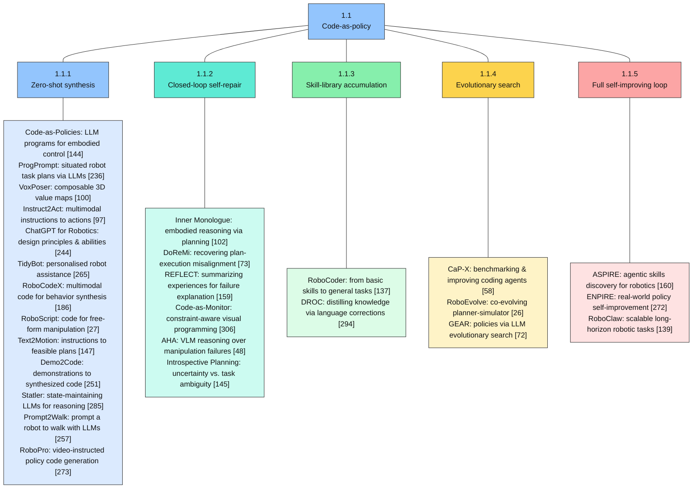
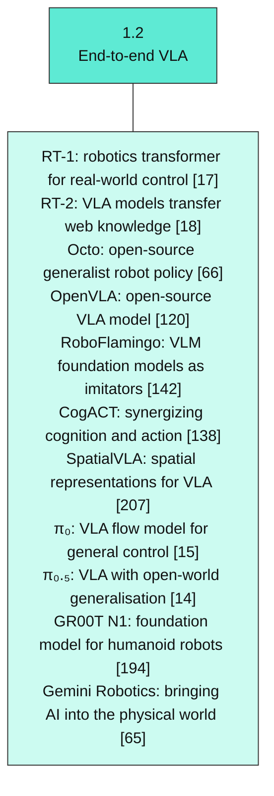
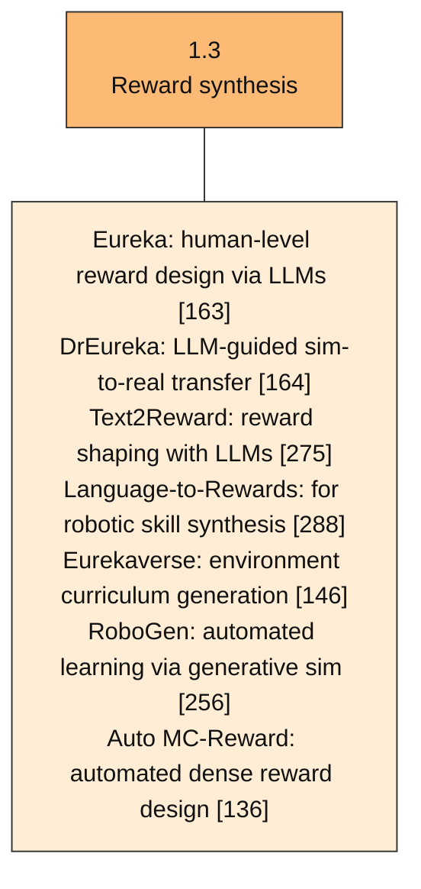
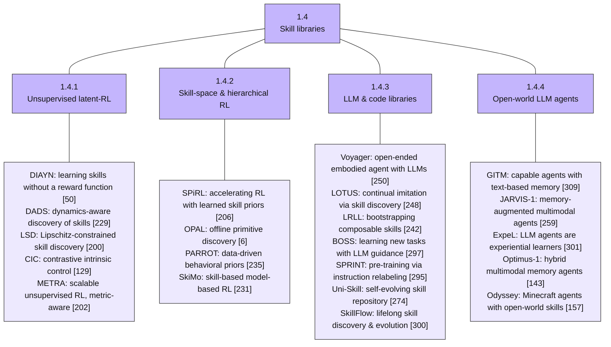
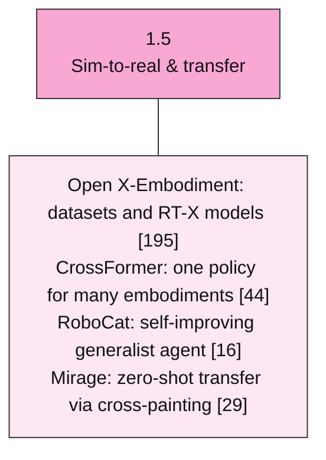
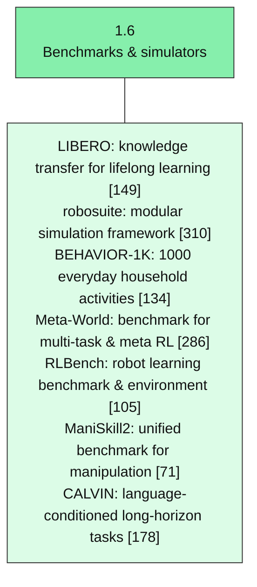

# Microduck-vision

> _A tiny biped robot that moves using reinforcement learning policies._
> —— [Microduck](https://github.com/pollen-robotics/microduck)

一个面向 MicroDuck 的桌面实验终端，把官方策略运行、MuJoCo 仿真、不同舵机测试、本地训练和实机控制放在同一个工作流里。  
核心目标是：**在官方已有成熟onnx的背景下，探索其他舵机 & 动力学条件 & 训练策略**

复现官方 ONNX + XL330 的运动轨迹是前期基准，HD1910 Compatible 接入官方 ONNX，用来验证仿真与执行流程可跨电机匹配，并为后续积累参考数据。

## 快速开始

当前桌面构建面向 Windows x64。准备 Rust 1.90 或更新版本、Node.js、pnpm、MSVC C++ 构建工具和 WebView2 运行时，然后在仓库根目录运行：

```bash
pnpm install
pnpm generate
pnpm dev
```

首次构建会下载锁定版本的 MuJoCo SDK 和 ONNX Runtime，需要网络连接。只运行桌面预览和官方 ONNX 策略，无需准备 Python 训练环境。

### 运行官方策略

1. 创建或选择一台模拟机，选择要测试的模型。复现官方行为时先使用 XL330。
2. 在“策略”页按需下载 [microduck-policies](https://huggingface.co/pollen-robotics/microduck-policies) 提供的官方 ONNX。
3. 回到 ONNX 预览，选择模拟机和已缓存的策略，设置运动指令后开启控制环。

接入实机时，先在机器与调试页面确认连接、关节映射、方向和零位，再在 ONNX 预览中切换真机同步、开启力矩和真机控制环。

### 本地训练

本地训练需要支持 CUDA 的 NVIDIA GPU 和驱动，应用启动训练时会调用 `uv` 准备训练环境。

```powershell
.\target\bin\microduck-vision.exe --help | Out-Host
```

### 检查与发布

```bash
pnpm release # 默认发布目录 `target/bin/`
```

## 和官方的关系

官方代码保存在 [vendor/microduck](vendor/microduck) 和 [vendor/microduck_rl](vendor/microduck_rl)，固定在发布版本并直接复用。桌面端围绕这些实现组织机器配置、执行、预览和训练流程。

### 直接复用

- `microduck_rl` 的 MJCF、网格和训练环境。MJCF 与网格在编译时从锁定的 vendor 版本读取；MuJoCo 从内存加载资源，3D 视图读取随应用分发的同源 STL。
- `microduck` 的标准关节定义、运动学，以及 `duck-control` 中的观测构建、策略执行等模块。
  - 官方原运行逻辑分散在机器人运行端、仿真和训练工具中
  - 项目把执行流程整理为桌面端可以共同使用的控制环：读取反馈、构建观测、执行策略、生成关节目标，再交给模拟或实机后端
  - 各包细节描述可查看crates/*/Cargo.toml.description
- 纯 Web 仿真也可参考官方的 [microduck-simulator](https://huggingface.co/spaces/pollen-robotics/microduck-simulator/blob/main/README.md)

### 仿真与不同舵机

策略通过约定的观测和动作接口工作，观测包含关节位置与速度、机体角速度、重力方向、上一帧动作及运动指令；底层可以用仿真反馈或实机反馈提供这些数据。  
因此可以复用同一套策略执行流程，比较不同模型的表现；当前模型统一使用 vendor 提供的 `scene_backlash.xml` 和 `robot_groundcontact_backlash.xml`，包含每个舵机关节的被动背隙。  
模型差异集中在 [models](apps/body-runtime/src/models)：

| 模型              | 用途                                                                  |
| ----------------- | --------------------------------------------------------------------- |
| XL330             | 官方策略与运动轨迹的参考模型。                                        |
| HD1910 Compatible | 在 HD1910 参数上加入位置刚度补偿及响应拟合，尝试接近 XL330 的运动模型 |
| HD1910            | 使用 HD1910 电机参数，观察原生响应。                                  |

运动结果同时取决于机体几何、质量与惯量、接触、电机响应、反馈和控制时序。  
更换舵机后，机械尺寸、质量分布和动力学差异需要测量与验证，域随机化也需要覆盖相应变化。  
当前沿用官方机体几何与惯性数据，HD1910 兼容模型的轨迹拟合是仿真中的近似。复用官方 ONNX 并不意味着舵机的实机会产生相同运动，但实机验证几乎能做到大致相同；

## ON MY WAY

> 自训练 ONNX 默认加载 %APPDATA%/microduck-vision/policies/trained/****/manifest.json  
> aaa

- [x] DeepMimic 风格的运动模仿训练。
- [ ] DeepMimic -> Eureka

---

开发约定见 [AGENTS.md](AGENTS.md)。

# 附录

> Robot-learning techniques for PhysicalAI [原论文（arXiv v1）](https://arxiv.org/abs/2608.01851v1)

## 1.1 Code-as-policy



## 1.2 End-to-end VLA



## 1.3 Reward synthesis



## 1.4 Skill libraries



## 1.5 Sim-to-real & transfer



## 1.6 Benchmarks & simulators

